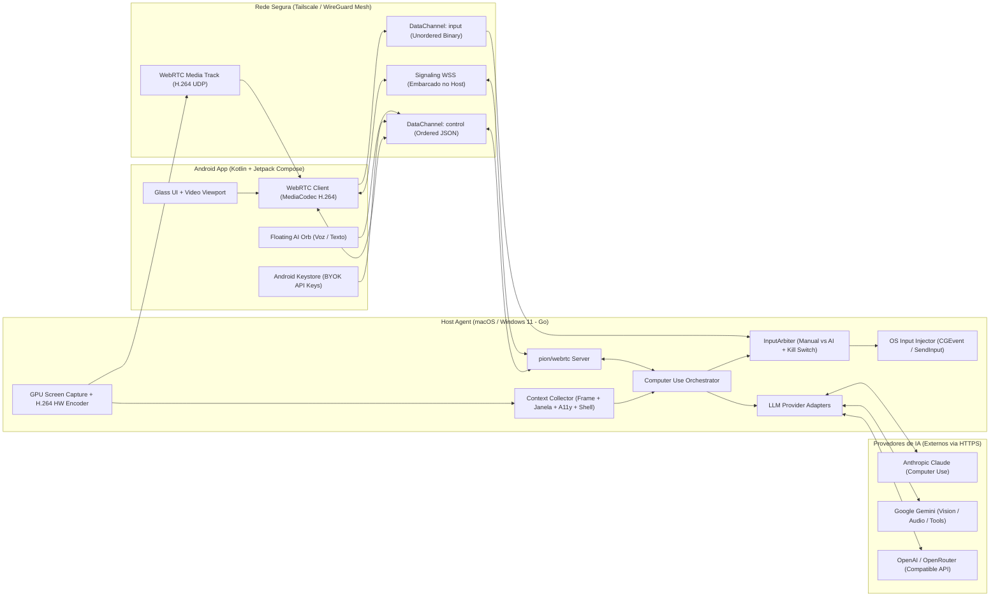
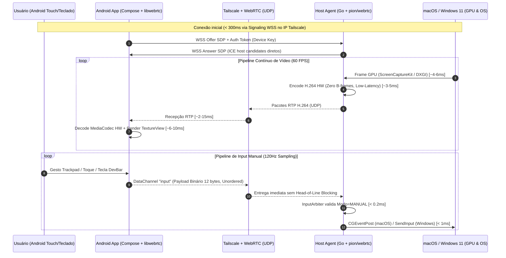
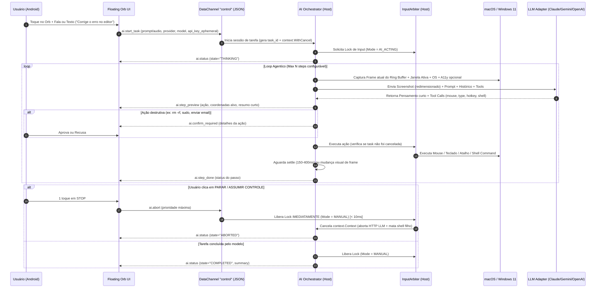
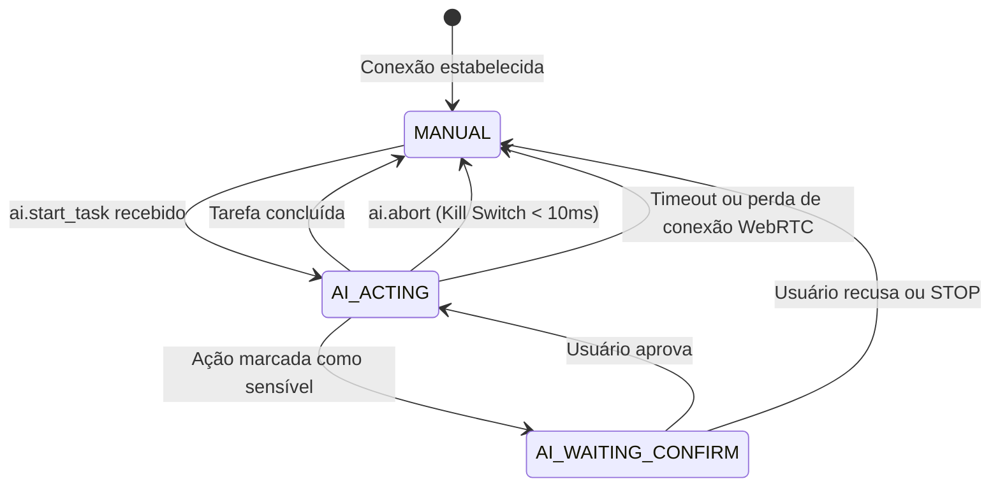

# Arquitetura do Sistema

Voltar para [[00-INDEX]] | Ver decisões em [[02-ADR-DECISIONS]] | Ver UI em [[04-UI-DESIGN-SYSTEM]]

---

## 1. Visão Geral de Componentes

O sistema segue uma topologia **Client-to-Host Direta (P2P sobre Mesh VPN)**, eliminando servidores intermediários de vídeo e mantendo o Orquestrador de IA colocalizado no Host para mínima latência de captura e controle determinístico do Kill Switch.



---

## 2. Fluxo A — Modo Padrão: Controle Manual + Streaming de Vídeo (< 50ms)

Neste modo, **todo o subsistema de IA permanece 100% dormente** (zero consumo de tokens, zero capturas extras de PNG/JPEG, zero alocação de contexto).



### Budget de Latência Alvo (LAN / Wi-Fi 5-6GHz)
| Etapa | Tempo Alvo | Técnica |
| :--- | :--- | :--- |
| Captura de tela (GPU) | `4 - 6 ms` | `ScreenCaptureKit` (macOS) / `DXGI Desktop Duplication` (Windows) |
| Encode H.264 Hardware | `3 - 5 ms` | `VideoToolbox` / `NVENC` / `MediaFoundation` (`Baseline/Main`, zero B-frames) |
| Transporte de Rede (UDP) | `2 - 15 ms` | WebRTC SRTP direto sobre Tailscale (WireGuard kernel/userspace) |
| Decode + Render Android | `6 - 10 ms` | `MediaCodec` hardware decoder + `TextureView` (suporte a blur real) |
| **Total Glass-to-Glass** | **`15 - 36 ms`** | **Folga confortável abaixo da meta de `< 50 ms`** |

---

## 3. Fluxo B — Modo Agente: Loop de Computer Use Sob Demanda

O vídeo continua fluindo pelo **Fluxo A** sem interrupção para que o usuário assista em tempo real a cada movimento do cursor e digitação do agente, com **Kill Switch** sempre acessível em 1 toque.



---

## 4. Arquitetura de Arbitragem de Input & Segurança (`InputArbiter`)

O `InputArbiter` é uma máquina de estados central no Host Agent que garante que nunca haja conflito entre o usuário e o agente de IA.



### Regras do `InputArbiter`
- **Heartbeat Fail-Safe:** Se o DataChannel desconectar ou ficar > 3s sem ping durante `AI_ACTING`, o Host **aborta automaticamente** o agente e encerra subprocessos shell órfãos.
- **Normalização de Coordenadas (HiDPI / Retina):**
  - Telas Retina no macOS (2x) e Windows (125%/150%/200% DPI scaling) causam erros clássicos de clique em agentes de Computer Use.
  - O Host mantém uma matriz canônica `CoordinateMapper`:
    - O modelo recebe imagens em resolução padronizada (ex: `1280x800` ou `1366x768`, respeitando o aspect ratio e as recomendações de cada provedor, como a escala nativa do Anthropic Computer Use).
    - As coordenadas `(x_norm, y_norm)` retornadas pela IA são convertidas para coordenadas lógicas do SO alvo (`CGDisplayBounds` no macOS / `GetSystemMetrics` + `MonitorFromPoint` no Windows) antes de injetar o clique.

---

## 5. Arquitetura Model-Agnostic (Strategy / Adapter Pattern)

Para suportar troca instantânea de chaves e modelos sem reescrever o loop de controle, o Orquestrador fala apenas com uma interface interna canônica:

```go
type LLMProvider interface {
    Name() string
    Capabilities() ProviderCapabilities // NativeComputerUse, NativeAudio, MaxImageDim
    NextAction(ctx context.Context, req AgentTurnRequest) (AgentTurnResponse, error)
}
```

### Adapters Planejados
1. **`AnthropicAdapter` (Claude):**
   - Usa a tool nativa `computer_20250124` (ou versão mais recente suportada pela API) + tool `bash` / `shell`.
   - Mantém o screenshot dentro da faixa recomendada (`<= 1280x800` / `~1.15MP`) para precisão máxima de clique.
2. **`GeminiAdapter` (Google Gemini):**
   - Suporta entrada multimodal direta (**Screenshot + Áudio bruto do Orb** em uma única chamada, eliminando um passo extra de STT quando o usuário escolher Gemini!).
   - Usa Function Calling tipado com coordenadas normalizadas `0..1000` (padrão nativo de grounding do Gemini) + `shell_exec`.
3. **`OpenAICompatAdapter` (OpenAI / OpenRouter / Local):**
   - Compatível com `/v1/chat/completions` (ou `/v1/responses`), visão via base64 JPEG/WebP + Function Calling unificado (`mouse_move`, `mouse_click`, `key_type`, `key_combo`, `scroll`, `shell_exec`, `task_complete`).
   - Permite configurar `base_url` customizada (ex: `https://openrouter.ai/api/v1`) diretamente no app Android.

### Gestão Segura de API Keys (BYOK)
- Armazenadas no **Android Keystore** (`EncryptedSharedPreferences`).
- Enviadas ao Host **somente dentro do canal WebRTC DTLS-SRTP autenticado sobre Tailscale** (criptografia dupla: WireGuard + DTLS 1.3), mantidas apenas em memória no Host durante a sessão ativa (ou opcionalmente salvas no Keychain/Credential Manager local se o usuário preferir modo headless).

---

## 6. Protocolos de Rede e Payloads

### A. DataChannel `input` (Binário, Unordered, `maxRetransmits: 0`)
Usado para movimentos de cursor e scroll de alta frequência (até 120Hz):
- `Byte 0`: `EventType` (`0x01` MouseMoveRel, `0x02` MouseMoveAbs, `0x03` MouseButton, `0x04` Scroll)
- `Bytes 1..4`: `int16 dx/x`, `int16 dy/y` (coordenadas normalizadas `0..65535` para absoluto, ou delta pixel para trackpad)
- `Byte 5`: `Flags/Buttons` (bitmask: Left, Right, Middle, Modifiers)
- Total: **6 a 12 bytes por pacote** — zero parsing JSON no hot-path.

### B. DataChannel `control` (JSON, Ordered, Reliable)
Usado para eventos discretos e orquestração do Agente:
- `key.event`: tecla + modificadores + mapeamento inteligente (ex: `PRIMARY+C` vira `Cmd+C` no macOS e `Ctrl+C` no Windows).
- `host.info`: OS, monitores, resolução, escala DPI, nome da máquina.
- `ai.start_task` / `ai.abort` / `ai.confirm_response`
- `ai.status` / `ai.step_preview` / `ai.step_done` / `ai.overlay_highlight` (desenha um halo sutil na tela do Android mostrando onde o agente vai clicar).

---

## 7. Estrutura do Monorepo Sugerida

```text
any-dask/
├── docs/
│   └── vault/                      # Obsidian Memory Bank (sempre atualizado)
│       ├── 00-INDEX.md
│       ├── 01-ARCHITECTURE.md
│       ├── 02-ADR-DECISIONS.md
│       ├── 03-BACKLOG-PROGRESS.md
│       └── 04-UI-DESIGN-SYSTEM.md
├── host/                           # Host Agent Unificado (macOS + Windows 11 - Go)
│   ├── cmd/
│   │   └── anydask-host/           # Entrypoint CLI / Daemon
│   ├── internal/
│   │   ├── signaling/              # WSS Signaling + Pairing Auth (Token/QR)
│   │   ├── webrtc/                 # pion/webrtc PeerConnection, VideoTrack, DataChannels
│   │   ├── capture/                # Interface ScreenCapturer + Frame RingBuffer
│   │   │   ├── darwin/             # macOS: ScreenCaptureKit + VideoToolbox H.264
│   │   │   └── windows/            # Windows: DXGI Desktop Duplication + MF/NVENC H.264
│   │   ├── input/                  # InputArbiter + CoordinateMapper + Injeção OS
│   │   │   ├── darwin/             # macOS: CGEventPost + Keycode Map
│   │   │   └── windows/            # Windows: SendInput + VirtualKey Map
│   │   ├── context/                # Janela ativa, A11y tree (AXUI / UIA), Shell executor
│   │   └── agent/                  # Computer Use Orchestrator
│   │       ├── orchestrator.go     # Loop Vision -> Plan -> Act -> Verify + Kill Switch
│   │       ├── guardrails.go       # Detecção de ações destrutivas / confirmação
│   │       └── providers/          # Strategy/Adapter (BYOK)
│   │           ├── provider.go     # Interface canônica LLMProvider
│   │           ├── anthropic.go    # Claude Computer Use Adapter
│   │           ├── gemini.go       # Gemini Vision/Audio/Tools Adapter
│   │           └── openai.go       # OpenAI / OpenRouter Adapter
│   ├── scripts/                    # Installers (LaunchAgent macOS, Windows Service)
│   └── go.mod
├── android/                        # Cliente Mobile Android (Kotlin + Jetpack Compose)
│   ├── app/
│   │   └── src/main/
│   │       ├── java/com/anydask/
│   │       │   ├── data/           # WebRTC Client, Signaling, Keystore/Settings, Host Registry
│   │       │   ├── domain/         # Models, InputProtocol (Binary/JSON), AgentState
│   │       │   ├── ui/
│   │       │   │   ├── theme/      # Tokens Apple Glass, Cores, Tipografia, Shaders AGSL
│   │       │   │   ├── components/ # GlassCard, FloatingOrb, DevShortcutBar, ActionOverlay
│   │       │   │   └── screens/    # HostSwitcher, RemoteSession, Settings (API Keys)
│   │       │   └── audio/          # Captura de voz Push-to-Talk (PCM/Opus)
│   │       └── res/
│   ├── build.gradle.kts
│   └── settings.gradle.kts
├── protocol/                       # Contratos compartilhados & Schemas
│   ├── control-messages.schema.json
│   └── input-binary-spec.md
└── README.md
```
